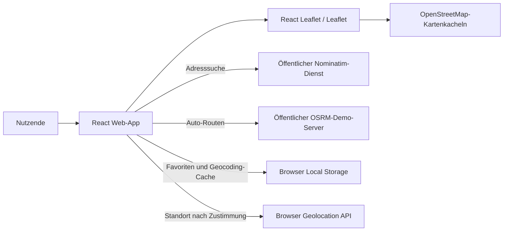

# CivixX – Knowledge Map

## Zweck und Produkt

CivixX ist eine interaktive Karte für Bildungseinrichtungen in Leipzig und Umgebung. Nutzende können Einrichtungen filtern, Adressen suchen, ihren Standort anzeigen lassen, eine Auto-Route vom Standort oder einem Kartenpunkt zu einer Einrichtung berechnen und Einrichtungen lokal als Favoriten merken. Eine Backend-Anbindung, Anmeldung oder Synchronisierung ist nicht aktiv.

## Systemübersicht



## Einstiegspunkte und wichtige Dateien

| Bereich | Datei | Zuständigkeit |
| --- | --- | --- |
| Projektbeschreibung | `README.md` | Produktüberblick, Funktionen und Entwicklungsbefehle |
| React-Einstieg | `dist-react/index.html`, `dist-react/src/main.jsx` | HTML-Shell, React-Mount, Leaflet-CSS und globale Styles |
| App-Komposition und Routing | `dist-react/src/App.jsx` | BrowserRouter und Routen für Karte, Rechtstexte und 404 |
| Hauptfunktionalität | `dist-react/src/components/CivixApp.jsx` | Kartenansicht, Suche, Routenberechnung, Geolocation, Marker und Favoriten |
| Entfernung und Sortierung | `dist-react/src/geo.js`, `dist-react/src/geo.test.js` | Entfernungsformel und Sortierung „nächste zuerst“, mit Tests |
| Einrichtungen | `dist-react/src/data/institutions.js` | Von Hand gepflegte Liste mit Adresse und Koordinaten sowie die Kategorien |
| Persistenz-Hook | `dist-react/src/hooks/useLocalStorage.js` | JSON lesen/schreiben, Fehler des lokalen Speichers abfangen, Änderungen aus anderen Tabs übernehmen |
| Gemeinsames Seitenlayout | `dist-react/src/components/SiteLayout.jsx` | Header, Navigation, Footer und Rahmen für React-Seiten |
| UI-Bausteine | `dist-react/src/components/LegalPage.jsx`, `SectionLabel.jsx`, `CategoryShape.jsx` | Gemeinsames Layout der Rechtstexte, nummerierte Abschnittslabels und Kategorie-Formen (Liste, Filter, Kartenmarker) |
| Rechtliche React-Seiten | `dist-react/src/pages/Privacy.jsx`, `dist-react/src/pages/Cookies.jsx`, `dist-react/src/pages/Terms.jsx` | Datenschutz, Cookie-Hinweise und Nutzungsbedingungen |
| Darstellung | `dist-react/src/index.css` | Design-Tokens (Swiss Style in den Farben von civixx.de: Tiefgrün `#0B3B2C`/Weiß/Hellgrün, Akzent `#2BB673`, keine Radien/Schatten), Muster-Klassen, Primitive (`.btn`, `.section-label`) sowie Layout- und Karten-Styles |
| Build-Konfiguration | `dist-react/vite.config.js`, `dist-react/package.json` | Vite-Konfiguration, Skripte und Abhängigkeiten |

## Hauptabläufe

### Adresssuche

1. Das Suchformular in `CivixApp.jsx` ruft `search` und darin `geocode` auf. Dasselbe Textfeld filtert beim Tippen die Einrichtungsliste.
2. Die App ruft den öffentlichen Nominatim-Endpunkt `search` auf und begrenzt die Suche auf Deutschland sowie das Leipziger `BOUNDS`-Rechteck.
3. Erfolgreiche Geocoding-Ergebnisse werden mit 24 Stunden Ablaufzeit im Browser unter `civixx.geocodeCache` gespeichert; beim Start werden nur noch gültige Cache-Einträge geladen.
4. Die Karte fliegt mit `FlyTo` zur Adresse und zeigt einen Marker. Das Textfeld wird geleert, damit die Liste alle Einrichtungen nach Entfernung zur Adresse zeigt.

### Liste, Auswahl und Favoriten

- Die Liste zeigt Entfernungen ab dem Standort bzw. Kartenpunkt, sonst ab der zuletzt gesuchten Adresse. Ohne beides ist sie alphabetisch sortiert.
- Eine Auswahl (Liste oder Marker) zeigt die Detailkarte, bewegt die Karte über `flyTarget` und entfernt eine vorhandene Route. Der Ausgangspunkt der Entfernungen ändert sich dadurch nicht.
- Favoriten werden als Liste von Einrichtungs-IDs unter `civixx.savedPlaces.v2` gespeichert; ältere Einträge mit ganzen Objekten werden beim Lesen auf die ID reduziert.
- Favoriten und Geocoding-Cache verlassen den Browser nicht.

### Routenberechnung

1. Startpunkt ist der Standort oder ein per Klick gesetzter Kartenpunkt, Ziel die ausgewählte Einrichtung. Ein Klick auf den Kartenpunkt entfernt ihn wieder.
2. „Route hierher“ fragt den öffentlichen OSRM-Demo-Server unter `router.project-osrm.org` mit dem Profil `driving` ab. Dabei verlassen die Start- und Zielkoordinaten den Browser.
3. Eine erfolgreiche GeoJSON-Geometrie wird in Leaflet-Koordinaten umgewandelt und als Polyline gezeichnet.

### Standort

- `navigator.geolocation` fragt den Browser nach Berechtigung und verwendet hohe Genauigkeit, ein Timeout von zehn Sekunden und einen maximal 30 Sekunden alten Messwert.
- Der Standort wird nur übernommen, wenn er innerhalb von `BOUNDS` liegt.

## Technische Bausteine

- React 19 und React DOM
- React Router DOM 7 für clientseitiges Routing
- Vite 8 mit React-Plugin
- React Leaflet 5 und Leaflet 1.9
- OpenStreetMap-Kacheln für die Karte
- Nominatim für Adress-Geocoding
- OSRM-Demo-Server für Auto-Routen
- Browser Local Storage für Favoriten und Geocoding-Cache
- Browser Geolocation API für die optionale Standortanzeige

## Geografischer Bereich

Die Karte startet bei Leipzig (`51.3397, 12.3731`) und wird durch `BOUNDS` in `dist-react/src/components/CivixApp.jsx` begrenzt. Die Adresssuche ist über Nominatim auf diesen Bereich begrenzt, der Standort wird dagegen geprüft. Änderungen an der unterstützten Region sollten Kartenbegrenzung und Ergebnisprüfungen gemeinsam berücksichtigen.

## Datenschutz und externe Abhängigkeiten

- Kartenkacheln werden von `tile.openstreetmap.org` geladen.
- Suchbegriffe gehen an den öffentlichen Nominatim-Dienst; Routing-Anfragen mit Start- und Zielkoordinaten gehen an `router.project-osrm.org`. Beides steht in der Datenschutzerklärung (`Privacy.jsx`) und muss dort bei Änderungen nachgezogen werden.
- Der Standortzugriff erfolgt über die Browser-API und erfordert Nutzerzustimmung.
- Favoriten und Geocoding-Cache liegen im Local Storage.
- Es gibt keine Anmeldung und keine serverseitige Synchronisierung.
- Rechtstexte liegen nur noch als React-Seiten unter `dist-react/src/pages/`.

## Entwicklung

In `dist-react/`:

```bash
npm install
npm run dev
```

Produktions-Build und lokale Vorschau:

```bash
npm run build
npm run preview
```

Zusätzlich sind `npm run lint` (Oxlint) und `npm test` (Node-Testrunner, `src/geo.test.js`) definiert.

## Bekannte Zustände und zu beachtende Punkte

- Die React-App unter `dist-react/` ist die einzige Version; die ältere Standalone-`index.html` im Projektstamm wurde entfernt.
- Nominatim und der OSRM-Demo-Server sind öffentliche Dienste. Verfügbarkeit und Nutzungsbedingungen liegen außerhalb der App; der lokale Cache betrifft nur Geocoding-Ergebnisse, nicht die Kartenkacheln oder Routen.
- Die App nutzt `BrowserRouter`. Der Webserver muss unbekannte Pfade auf `index.html` umleiten, sonst führen direkte Aufrufe wie `/datenschutz` zu 404.

## Orientierung für Änderungen

- UI und Nutzerabläufe: `dist-react/src/components/CivixApp.jsx`
- Kategorien: `dist-react/src/data/institutions.js` – jede Kategorie hat eine Form (`shape`, SVG-Pfad) statt einer Farbe; der Akzent (Grün) ist für Auswahl und Route reserviert
- Kartenregion oder Startansicht: Konstanten `LEIPZIG` und `BOUNDS` in `CivixApp.jsx`
- Local Storage-Verhalten: `dist-react/src/hooks/useLocalStorage.js`
- Routing und 404: `dist-react/src/App.jsx`
- Gemeinsamer Seitenrahmen: `dist-react/src/components/SiteLayout.jsx`
- Rechtstexte: `dist-react/src/pages/`
- Globale Gestaltung: `dist-react/src/index.css`
- Abhängigkeiten und Befehle: `dist-react/package.json`
